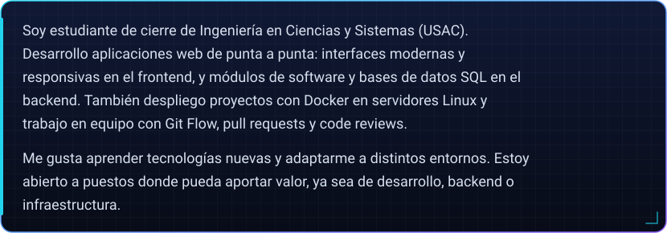

📍 Ciudad de Guatemala &nbsp;·&nbsp; 🎓 Universidad de San Carlos de Guatemala

<picture>
  <source media="(prefers-color-scheme: dark)" srcset="https://raw.githubusercontent.com/IsaiDardonMayen/IsaiDardonMayen/output/pacman-contribution-graph-dark.svg">
  <source media="(prefers-color-scheme: light)" srcset="https://raw.githubusercontent.com/IsaiDardonMayen/IsaiDardonMayen/output/pacman-contribution-graph.svg">
  
</picture>

---

---

  

---

---

&nbsp;&nbsp;&nbsp;&nbsp;

---

&nbsp;&nbsp;&nbsp;&nbsp;

---

---

